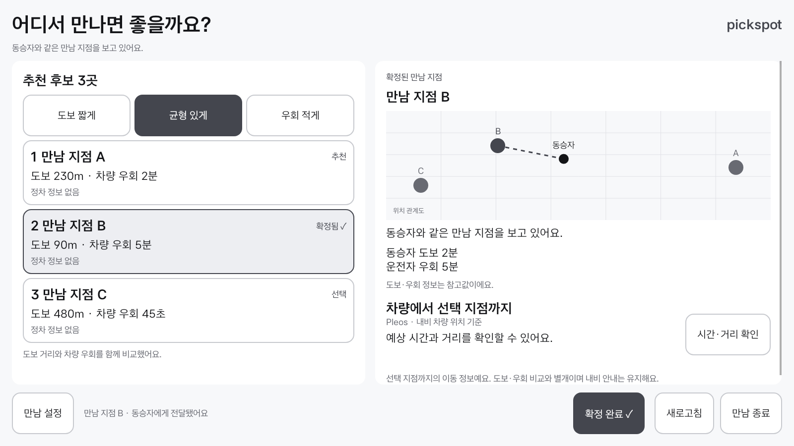

# 픽스팟 · Pickspot

운전자의 차량 우회와 동승자의 도보 부담을 함께 비교하고, 합의한 만남 지점을 차량과 웹에 공유하는 Pleos Connect 차량용 앱입니다. 현재 버전은 **0.28.0 (versionCode 29)** 입니다.

후보 미리보기와 약속 장소 확정을 분리했습니다. 다른 후보를 살펴봐도 기존 약속은 유지되고, 변경 버튼을 눌렀을 때 양쪽 화면이 함께 바뀝니다.



## 제출물과 실행 구성

| 구성 | 파일 | 포함 범위 |
|---|---|---|
| 서명된 release APK | `apk/Pickspot_픽스팟_release.apk` | 서버 없이 고정 후보 비교, 차량 UI, Pleos 어댑터. 웹 참가·확정 동기화가 없는 오프라인 구성 |
| 연결 시연용 debug APK | `apk/Pickspot_connected_debug.apk` | 로컬 서버와 `competition` 실행 옵션으로 참가·공유·비교·확정·변경·종료 실행 |
| 전체 소스 | `app/`, `server/`, `scripts/` | Android 앱, 동승자 웹, 서버와 검사 코드 |
| 화면 자료 | [단계별 이미지](docs/ui/README.md) | v0.27 용어 변경 전 차량 36장·웹 8장, 고정 상태 재현. `docs/ui/index.html`을 로컬에서 열면 테마별 보기 가능 |
| 촬영 시나리오 | [VIDEO_SCENARIO.md](docs/VIDEO_SCENARIO.md) | 약 3분 20초 조작·내레이션·확인 항목과 90초 축약안 |

두 APK는 앱 ID가 같고 서명이 다릅니다. 서로 덮어 설치되지 않을 수 있으므로 별도 테스트 환경을 사용하거나 기존 설치 상태를 확인하세요. 기존 앱 삭제는 로컬 만남 상태를 지울 수 있습니다. 연결 시연 영상을 release 단독 실행 화면으로 설명하지 않습니다.

체크섬은 [apk/SHA256SUMS](apk/SHA256SUMS)에 있습니다. release 서명과 `debuggable=false`를 확인했으며, 이번 제출용 서명 APK의 별도 설치·실행 검증은 아직 하지 않았습니다. 현재 가상 차량 실행 확인은 debug 연결 구성으로 수행했습니다.

## 개발 및 확인 환경

- macOS / Apple Silicon, Android Studio의 Pleos Connect 가상 차량
- Pleos 시스템 이미지: Android API 34, ARM64, 사용자 10, `emulator-5554`
- 가상 차량: 2560×1440, density 160. 상태 이미지 렌더: 1600×900
- JDK 17, Android SDK compile/target 35, min 28, Build Tools 35.0.0
- Gradle 8.10.2, Android Gradle Plugin 8.8.2, Kotlin 2.0.0
- Node.js 22 이상. 현재 검증은 Node.js 24 환경
- Pleos 의존성: NaviHelper 3.0.5, FusedLocation 1.1.3, Vehicle 2.3.2

Pleos 시스템 이미지는 재배포하지 않습니다. [공식 개발 안내](https://appdevchallenge.auto-hmg.io/guide/development)에 따라 Android Studio에 설치하세요. 최초 빌드는 Gradle 및 Google/Maven/Pleos 의존성 다운로드가 필요합니다. Pleos Maven 주소는 `settings.gradle.kts`에 있습니다.

## 소스 빌드

Android Studio에서 최상위 폴더를 열거나 아래 명령을 실행합니다. JDK 17의 `JAVA_HOME`과 SDK의 `ANDROID_HOME`을 지정하세요. `scripts/env.sh`에는 개발자의 절대 경로가 없습니다.

```bash
source scripts/env.sh
./gradlew exportDebugApk :app:assembleRelease :app:testDebugUnitTest :app:lintDebug
node --test server/test/*.test.mjs
```

Debug 결과는 `artifacts/pickspot-demo.apk`입니다. 빌드 출력은 macOS의 `~/Library/Caches/Pickspot/<경로해시>/`, 기타 OS의 `~/.cache/Pickspot/<경로해시>/`에 있으며 `-Ppickspot.buildRoot=/원하는/경로`로 변경할 수 있습니다. `assembleRelease`는 서명 전 APK를 만듭니다. 서명 키는 포함하지 않았으므로 별도 키로 서명해야 합니다.

## 전체 연결 흐름 실행

1. Pleos 가상 차량을 켜고 부팅을 기다립니다. 실행기는 `emulator-5554`, 현재 사용자 10인 가상 차량을 확인합니다.
2. Mac에서 `./competition-demo.command`를 실행합니다. 앱 빌드·설치, 로컬 서버, 8788 연결과 앱 실행을 준비합니다. 터미널은 열어 둡니다.
3. 같은 Mac에서 `http://127.0.0.1:8788/`을 엽니다. 휴대폰 접속 주소가 아닙니다.
4. 차량에서 새 만남을 시작하고 12자리 코드를 웹에 입력합니다.
5. 웹에서 지정 위치 공유에 동의하고 공유하면 차량에 A·B·C 후보가 나타납니다.
6. 선호 기준과 카드를 비교합니다. B 미리보기만으로 웹 지점이 확정되지 않는지 확인합니다.
7. **이 지점에서 픽업하기**로 B를 확정합니다. 웹 B·도보 2분·추가 우회 5분을 확인합니다.
8. C를 미리 보고 웹 B 유지 확인 → **이 지점으로 변경** → 웹 C·도보 7분·우회 45초를 확인합니다.
9. **시간·거리 확인**으로 Pleos 실제 응답을 확인합니다. 실패하면 실패 상태를 표시합니다.
10. 웹 공유 종료 후 차량 종료 화면을 확인합니다. 서버 터미널에서 Control+C로 종료합니다.

실행기는 macOS용입니다. 다른 환경에서는 아래처럼 직접 연결할 수 있습니다. 서버 터미널을 유지하고 별도 터미널에서 ADB 명령을 실행합니다.

```bash
node server/competition-server.mjs --serve
# 별도 터미널: SDK platform-tools를 PATH에 추가
adb -s emulator-5554 reverse tcp:8788 tcp:8788
adb -s emulator-5554 install --user 10 -r apk/Pickspot_connected_debug.apk
adb -s emulator-5554 shell am force-stop --user 10 dev.pickspot.app
adb -s emulator-5554 shell am start --user 10 -n dev.pickspot.app/.MainActivity --es demo_scenario competition
```

이 구성은 지정 위치·고정 비교값을 쓰며 TMAP 키, 실제 GPS, 외부 HTTPS가 필요 없습니다. 후보는 계산 후 30분, 만남은 시작 후 60분간 유지됩니다. 재계산은 후보가 없으면 중앙 버튼, 후보가 있으면 **픽업 설정**에 있습니다. 만료되면 새 만남을 만드세요.

## 구현 범위와 제약

구현한 핵심은 세 가지 선호 비교, 후보 미리보기, 명시적 확정, 기존 확정 유지, 변경 후 웹 반영, 참가·공유 동의·종료·만료·재연결입니다. 가로 2열 화면, 밝은/어두운 테마와 주행 UX 제한 상태를 지원합니다.

Pleos NaviHelper는 선택 지점까지 시간·거리 미리보기에 사용합니다. 요청을 직렬화하고 늦은 응답의 대상 혼동을 방지합니다. FusedLocation 위치·정확도 수신/해제, 별도 실제 위치 공유 웹, TMAP 경로 어댑터도 구현했지만 기본 연결 흐름에 모두 통합된 상태는 아닙니다.

현재 A·B·C 비교값은 고정 데이터이며, 위치 관계도는 실제 도로 지도가 아닙니다. 차량 추가 우회와 Pleos 차량→선택 지점 시간·거리는 의미가 다릅니다. 실제 위치·경로를 기본 추천으로 통합하는 기능, 도로 지도와 음성은 후속 범위입니다. 자동 경유지 추가는 에뮬레이터의 경유지 좌표가 (0,0)으로 반환되는 문제로 비활성이며, 현재 조회는 내비 안내를 바꾸지 않습니다. Vehicle 의존성이 있다는 사실을 속도·기어 기반 기능의 완성으로 설명하지 않습니다.

## 유지보수 구조

| 위치 | 역할 |
|---|---|
| `app/src/main/.../ui`, `res/layout*`, `res/values*` | 화면 구성·문구·색상·크기 |
| `presentation` | 화면 상태, 사용자 동작, 비동기 응답 |
| `domain` | 추천·확정·주행 제한·만료·위치 유효성 규칙 |
| `navigation`, `location`, `driving` | Pleos 및 Android 차량 API 어댑터 |
| `app/src/debug` | 로컬·실제 공유·연결 시연 저장소와 도구 화면 |
| `app/src/release` | 오프라인 저장소 선택 |
| `server/public` | 동승자 웹과 표시 상태 |
| `server/routing`, `server/store.mjs` | 경로 제공자, 조회 예산, 만남 상태 |

UI 변경 시 화면·리소스를 우선 수정하고 추천/SDK 경계를 유지할 수 있습니다. 추천은 도보 거리, 추가 우회, 정차 정보 패널티의 정규화 가중합이며 사용자 효과를 검증한 통계는 아직 없습니다.

## 확인 결과

2026-11-15 기준 Android 단위 검사 188개, 서버·웹 검사 325개 통과. 최종 제출 사본의 Lint 오류 0개·경고 23개, 화면 크기·테마 조합 8개 렌더 점검. 실제 가상 차량·웹에서 B 확정, A 확정 후 C 변경, 종료 동기화를 확인했습니다. Pleos 고정 지점 2곳 SDK 응답과 조회 중 경로 변경 0회도 별도 확인했습니다. 실차 주행·상용 운영 검증을 뜻하지 않습니다.

[검사 요약](docs/validation.json)과 [화면 자료의 출처](docs/ui/README.md)를 참고하세요. UI 이미지 44장은 현재 레이아웃의 고정 상태 재현이며 실제 성공 영상의 대체 증빙이 아닙니다.

## 설정과 제출

`.env.*.example`은 빈 설정 예입니다. 키, 실제 위치, 접근 토큰, 서명 키와 개인정보가 담긴 지원서는 포함하지 않았습니다. 현재 연결 흐름에는 키가 필요 없습니다. 실제 위치 공유·외부 경로 서버는 별도 운영 설정이 필요하며 기본 시연으로 실행되지 않습니다.

`deployment/render.yaml`은 별도 휴대폰 공유 테스트용 구성 참고입니다. 이 저장소 생성이 배포를 실행하지는 않습니다. `server/catalog/yangjae-maebong.json`은 미확인 조사 기록이며 실제 승하차 가능 장소의 보증이 아닙니다.

[공식 제출 안내](https://appdevchallenge.auto-hmg.io/guide/submission)에 따라 APK를 `apk/`에 두었습니다. 제출 이메일에는 저장소 주소·최종 커밋·APK 경로·영상 링크를 적어야 합니다. 촬영 시나리오는 준비됐고 실제 제출 영상은 별도 녹화해야 합니다.

### v0.28 문구 변경

차량 앱과 동승자 웹의 만남·만날 지점 표현을 픽업·픽업 지점으로 통일했습니다. 기능과 통신 규약은 유지했습니다. 기존 화면 묶음과 촬영 시나리오는 v0.27 자료이며, 실제 조작 시 픽업으로 바뀐 버튼명을 사용하세요.
